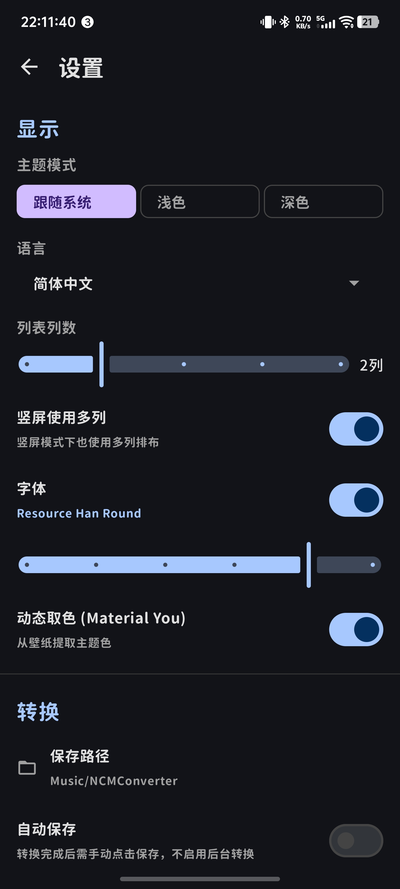
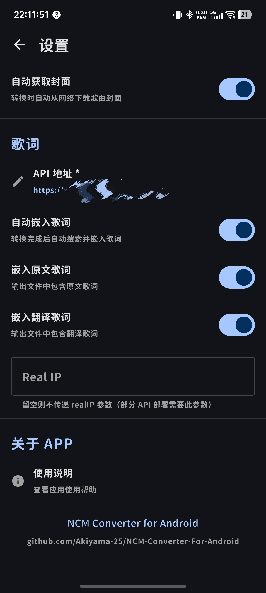
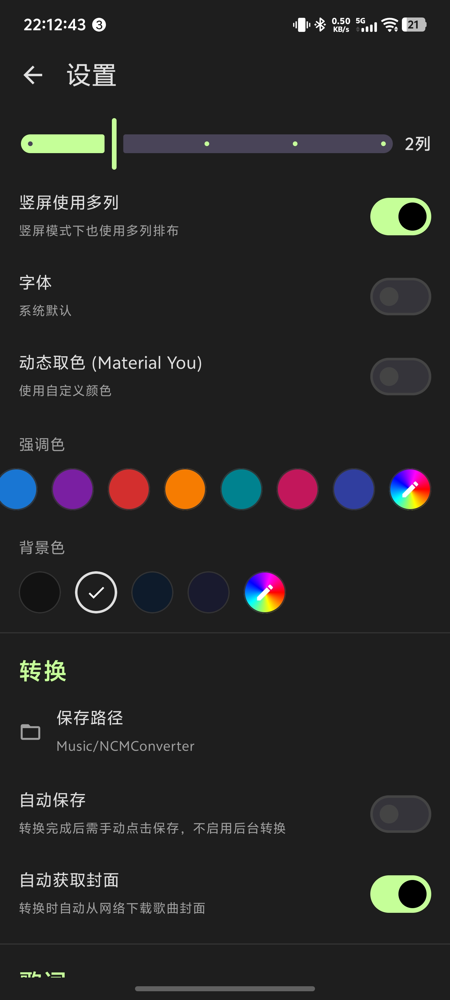
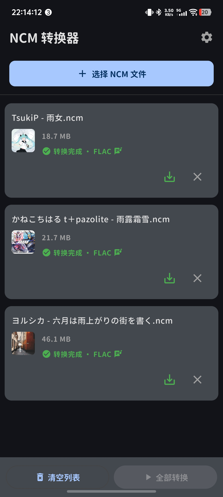
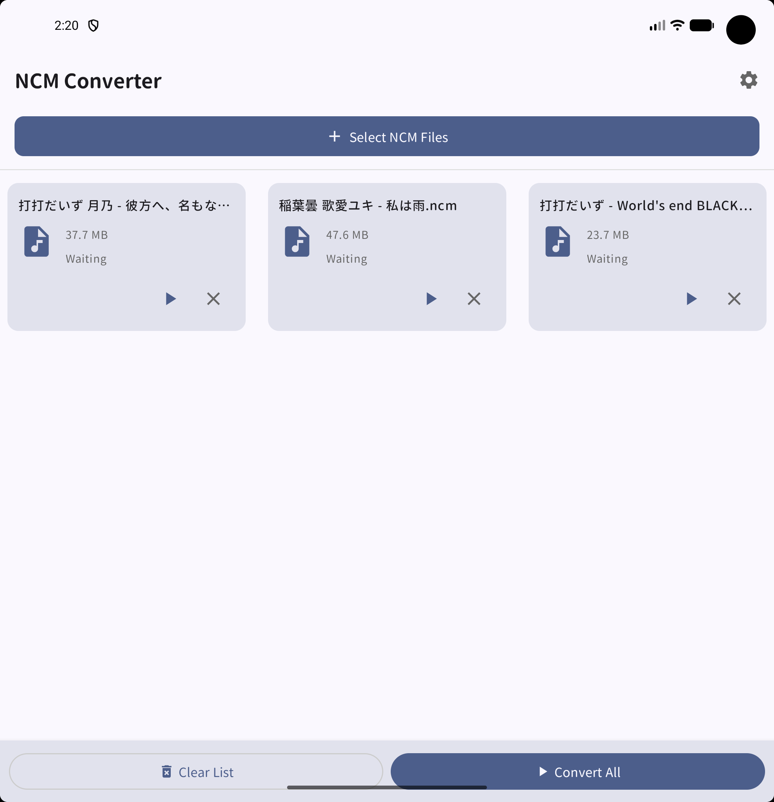
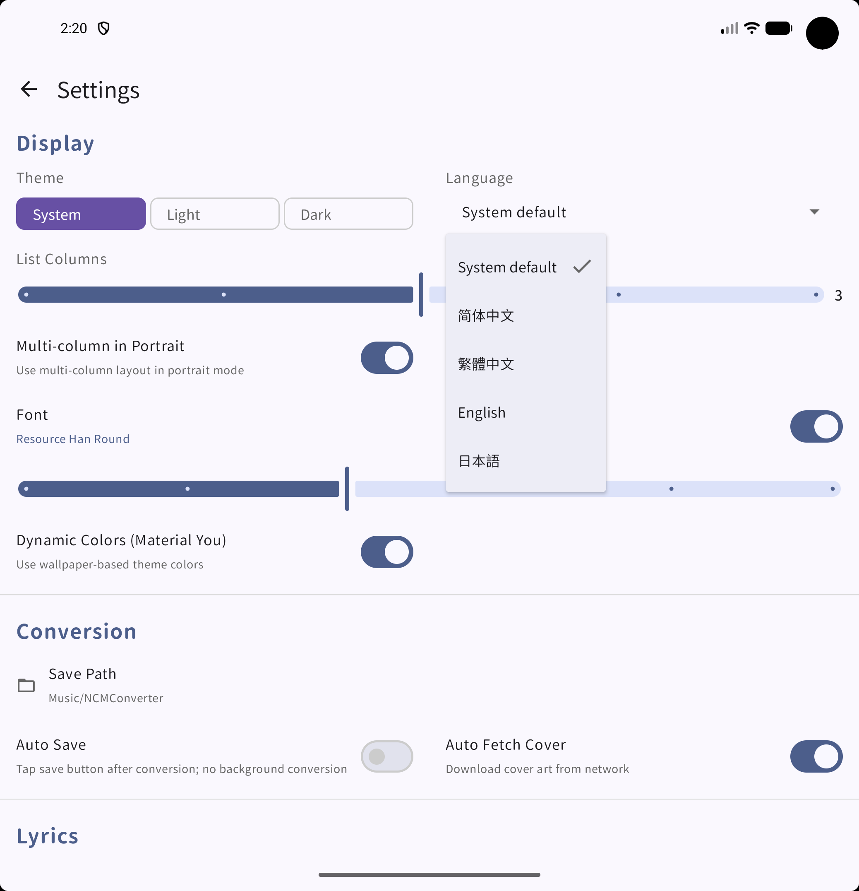

[简体中文](https://github.com/Akiyama-25/NCM-Converter-For-Android/blob/main/README.md) | [繁體中文](https://github.com/Akiyama-25/NCM-Converter-For-Android/blob/main/README_TC.md) | [日本語](https://github.com/Akiyama-25/NCM-Converter-For-Android/blob/main/README_JA.md)

# NCM Converter

An Android app that decrypts NetEase Cloud Music's encrypted `.ncm` files into standard MP3 or FLAC format.

## Features

- Batch conversion with no file limit
- Automatic metadata writing (title, artist, album, cover art)
- Automatic lyric search and embedding with independent original/translated switches
- System folder picker for export directory with DocumentTree persistent permission
- Background conversion: when auto-save is enabled, conversion runs in a foreground service with notification progress — switching apps won't interrupt it
- Material You dynamic colors (Android 12+)
- Custom accent and background colors via HSL sliders
- Multi-column grid layout, optimized for foldables and tablets
- Built-in Resource Han Round SC font with 6 customizable font weight levels
- Predictive back gesture support (Android 16+)
- Double-tap back to exit
- Automatic file list recovery after unexpected process death
- Multi-language support: Simplified Chinese, Traditional Chinese, English, Japanese

<p align="center">
  
  
  
  <br><br>
  
  
  
</p>

## Requirements

- Android 8.0 (API 26) or higher
- Android 16 (API 36) supported

## Tech Stack

- Kotlin + Jetpack Compose + Material 3
- Retrofit2 + OkHttp4
- AES-128-ECB / RC4 decryption
- MediaStore API / DocumentFile

## Build

```
git clone https://github.com/Akiyama-25/NCM-Converter-For-Android.git
cd NCM-Converter-For-Android
./gradlew assembleDebug
```

## Lyrics

The automatic lyrics embedding feature now includes built-in direct official NetEase API integration, working out of the box without requiring external cloud server deployments.

1. The app uses the built-in direct API by default—no server setup required to fetch and embed lyrics or cover art.
2. Once lyrics are enabled, you can independently control whether to embed "original lyrics" and "translated lyrics" (merged line-by-line when both are enabled).

> Note: The translated lyrics feature only supports Simplified Chinese translation results. When the app language is not Simplified Chinese, the translation switch will display a corresponding note.

## Reference Projects

The following projects were referenced during development:

- [rinchao0721/Melodia](https://github.com/rinchao0721/Melodia) — Architecture ideas and protocol reference for embedding direct, pure Kotlin encrypted NetEase official API client
- [Ame-Player](https://github.com/Akiyama-25/Ame-Player) — Client-side NetEase encrypted API and release signing workflow reference
- [NLyric](https://github.com/wwh1004/NLyric) — reference for lyrics matching strategy
- [openyyy.com](https://openyyy.com/) — reference for NCM format parsing

## License

This project is open-sourced under the [GPL v3](https://github.com/Akiyama-25/NCM-Converter-For-Android/blob/main/LICENSE) license.
